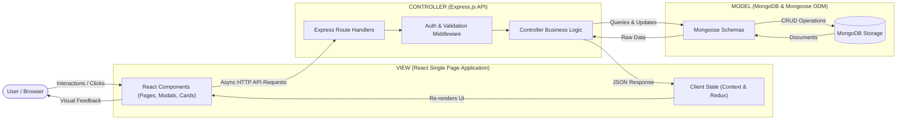

# HotelPro - Model-View-Controller (MVC) Pattern

HotelPro implements the industry-standard **Model-View-Controller (MVC)** architectural design pattern tailored to modern decoupled full-stack JavaScript (MERN).

---

## 1. Model (Data Structure & Business Rules)
* **Location:** `server/models/`
* **Role:** Defines the data structure, constraints, relationship references, and validation rules.
* **Implementations in HotelPro:**
  * `User.js` - User schema, password hashing pre-save hooks, role validation.
  * `Hotel.js` - Hotel properties, city indices, star classifications.
  * `Room.js` - Room numbers, pricing, occupancy capacity, operational status.
  * `Booking.js` - Reservation dates, total cost calculations, booking state machine.
  * `Payment.js` - Transaction records, method types, invoice generation logic.
  * `ServiceRequest.js` - In-house hospitality support tickets.

---

## 2. View (User Interface & Presentation)
* **Location:** `client/src/`
* **Role:** Renders data received from the backend, captures user interactions, and provides rich reactive visual feedback.
* **Implementations in HotelPro:**
  * `HomePage.jsx` - MakeMyTrip-inspired Hero search engine, destination cards, featured hotel showcase.
  * `RoomCatalogPage.jsx` - Dynamic filtering sidebar, room cards, sorting controls.
  * `RoomDetailsPage.jsx` - Photo galleries, room tier comparisons, amenity badges.
  * `GuestDashboard.jsx` - Booking management, invoice viewer, cancellation modals.
  * `StaffDashboard.jsx` - Live check-in arrivals board, housekeeping room matrix.
  * `AdminDashboard.jsx` - Financial analytics, revenue charts, room inventory controls.

---

## 3. Controller (Business Logic & Request Mediation)
* **Location:** `server/controllers/`
* **Role:** Receives incoming HTTP requests from the View, verifies permissions, invokes Models for database transactions, executes business logic, and returns formatted JSON responses.
* **Implementations in HotelPro:**
  * `authController.js` - Validates credentials, issues JWT bearer tokens, manages user profiles.
  * `roomController.js` - Executes complex query filters (price range, capacity, amenities, date availability).
  * `bookingController.js` - Verifies no overlap in reservation dates, creates bookings, processes cancellations.
  * `paymentController.js` - Handles payment verification, invoice creation, and refund records.
  * `staffController.js` - Coordinates room status transitions and housekeeping workflows.
  * `adminController.js` - Aggregates analytics, calculates occupancy percentages, generates monthly revenue series.
