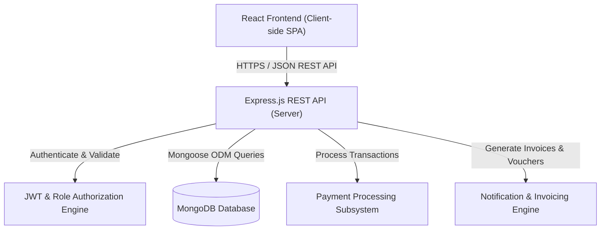

# HotelPro - Technical Architecture

## 1. System Overview
HotelPro is an enterprise-grade full-stack Hotel Booking and Management System built with the **MERN** technology stack (MongoDB, Express.js, React.js, Node.js). It follows a modern decoupled client-server architecture with RESTful API communication and stateless JSON Web Token (JWT) authentication.

---

## 2. Layered Architecture

The system is structured across 4 distinct layers adhering to the **Separation of Concerns (SoC)** principle:

### 1. Presentation Layer (Frontend - React)
* **Client Routing:** `react-router-dom` handles client-side routing with protected route wrappers (`ProtectedRoute`) according to authenticated user roles.
* **Component Architecture:** Atomic components (Navbar, HeroSearch, RoomCard, FilterSidebar, BookingModal, InvoiceModal) compose pages for Guests, Staff, and Administrators.
* **State Management:** Centralized AuthContext and BookingContext managing active session, JWT storage in `localStorage`, and reactive cart/booking states.
* **UI/UX Design:** MakeMyTrip-inspired premium aesthetics featuring a bold corporate blue palette, elevated card shadows, badge indicators (*MMT Assured / HotelPro Verified*), and responsive grids.

### 2. API Gateway & Routing Layer (Express.js)
* **Middleware Pipeline:**
  * CORS handler allowing secure cross-origin requests.
  * JSON body parsing and URL-encoded payload handling.
  * Request logging and error interceptor for centralized API responses.
* **Endpoint Segregation:** Dedicated route groups:
  * `/api/auth` - Authentication & user profile endpoints
  * `/api/hotels` - Hotel listings & city search
  * `/api/rooms` - Room catalog, dynamic filters, availability queries
  * `/api/bookings` - Reservation creation, history, cancellations
  * `/api/payments` - Transaction handling and invoice metadata
  * `/api/staff` - Check-in, check-out, housekeeping boards
  * `/api/admin` - Revenue analytics, occupancy metrics, system logs

### 3. Business Logic Layer (Controllers & Services)
* **Authentication Controller:** Handles bcrypt password hashing (salt factor 10) and JWT token generation (24-hour expiration).
* **Booking Controller:** Validates date availability preventing overlapping reservations, calculates dynamic pricing with seasonal surge rates, and verifies room capacity.
* **Staff Operations Controller:** Manages room status transitions (`Available` ➔ `Occupied` ➔ `Cleaning` ➔ `Available`) and handles service tickets.
* **Analytics Service:** Aggregates database records to output revenue graphs, monthly booking trends, and occupancy percentages.

### 4. Persistence Layer (MongoDB & Mongoose)
* **Document Database:** MongoDB stores flexible JSON-like documents with strict schema enforcement via Mongoose.
* **Indexing:** Compound indexes on `[hotelId, status]`, `[checkInDate, checkOutDate]`, and `[userId]` for high-throughput query optimization.
* **Referential Integrity:** Population queries linking Bookings with User, Hotel, and Room entities.
