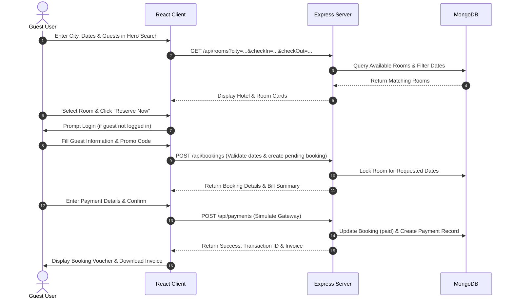
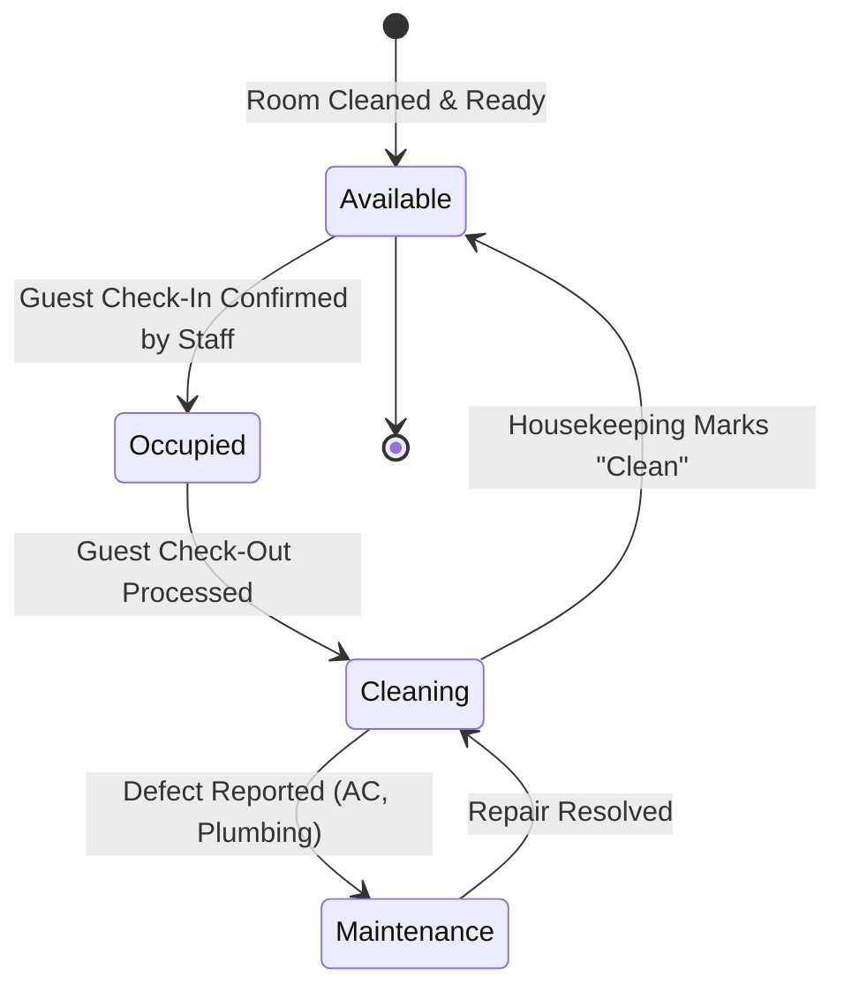
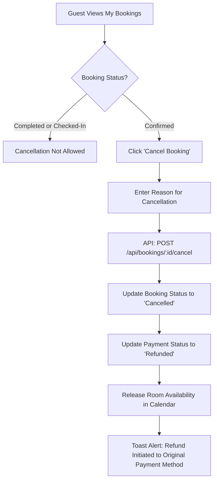

# HotelPro - User Flow Diagrams

This document illustrates the end-to-end operational workflows for Guests, Staff, and Administrators in HotelPro.

---

## 1. Guest Booking & Payment Flow

---

## 2. Staff Check-In & Housekeeping Flow

---

## 3. Cancellation & Refund Workflow

